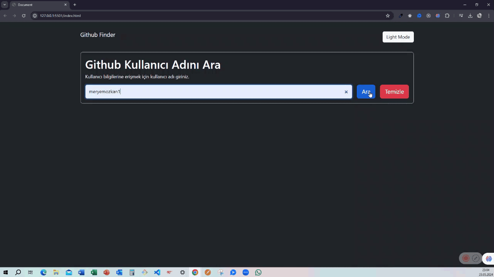

# 🔍 GitHub Finder | User & Repository Search Application

---

This repository features a modern and responsive web application designed to search and explore GitHub user profiles and repositories effortlessly. Powered by the GitHub REST API, the project allows users to look up specific accounts, view detailed profile statistics, inspect repositories, and discover top developers in real-time.

---

## 🚀 Live Demo
Explore the live website here: [GitHub Finder Live Site](https://meryemozkan1.github.io/Github-Finder/)

---

## ✨ Features

- **Advanced User Search:** Allows users to query and look up any GitHub profile instantly by entering a username.
- **Detailed Profile View:** Displays comprehensive profile details, including avatars, follower counts, bio, public repositories, and external links.
- **Repository Listing:** Automatically fetches and lists the user's public repositories with direct links.
- **Responsive Layout:** Optimized to provide a seamless user experience across mobile phones, tablets, and desktop devices.

---

## 🛠️ Technologies Used

- **HTML5:** Semantic structural markup.
- **CSS3 / Styling:** Custom modern design, clean spacing, and UI components.
- **JavaScript (ES6+):** Asynchronous API data fetching (Fetch API / Async-Await), dynamic DOM manipulation, and event handling.

---

## 📱 Interface Preview

---

